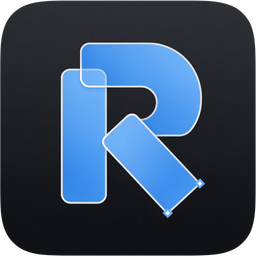
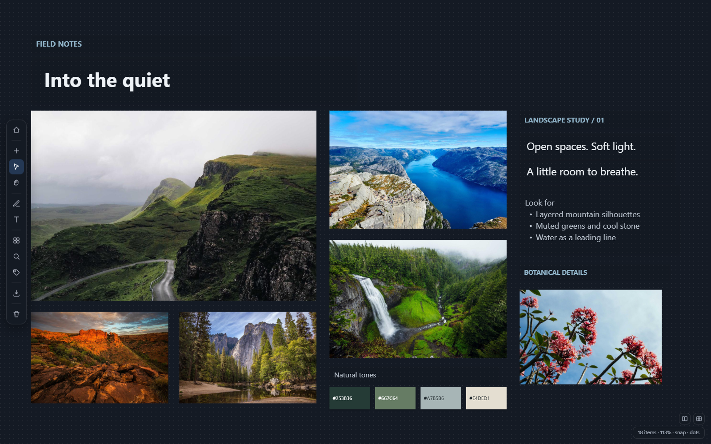
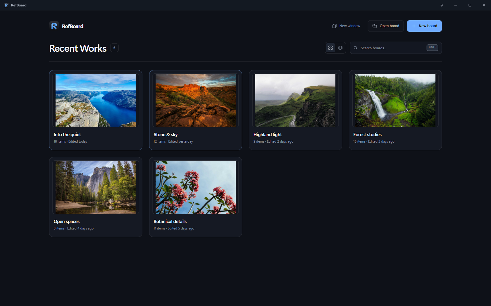
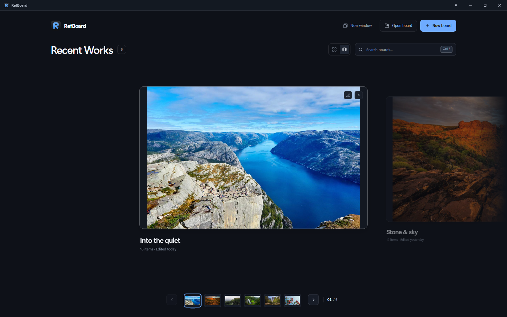
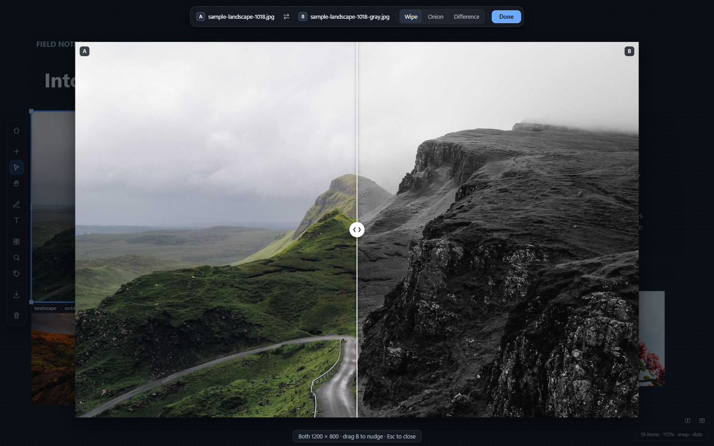
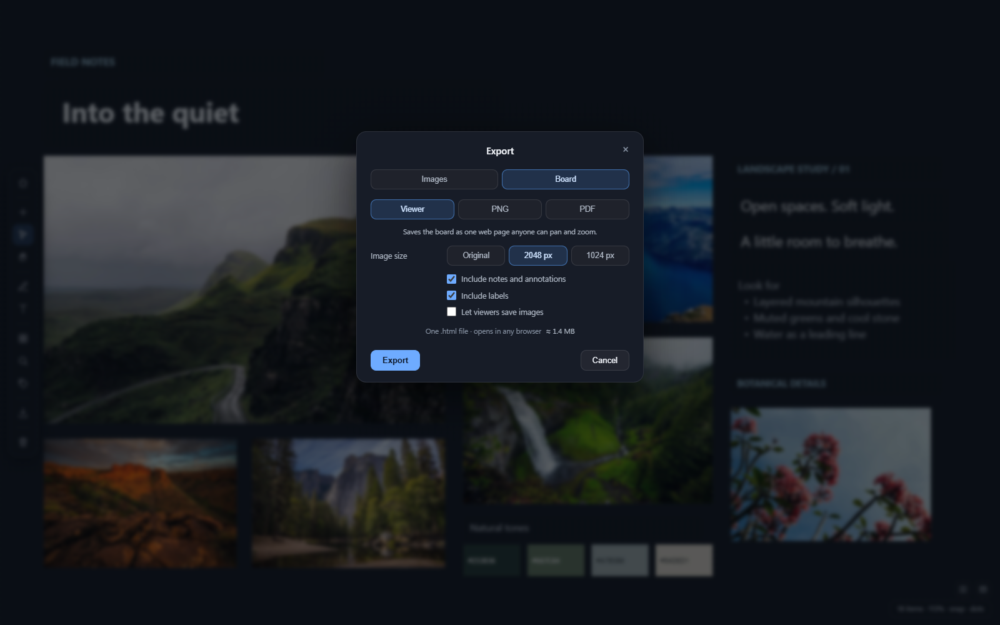
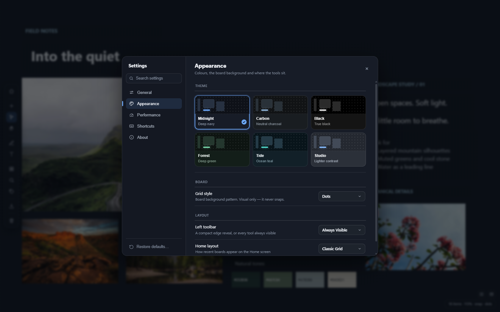

<p align="center">
  
</p>

<h1 align="center">RefBoard</h1>

<p align="center">
  <b>A free moodboard for Windows.</b><br>
  Drop in your reference images, arrange them, add notes, and keep them beside your work.<br>
  No account. No subscription. Everything stays on your PC.
</p>

<p align="center">
  <a href="https://github.com/sounak1125/RefBoard/releases/latest"></a>
  <a href="https://github.com/sounak1125/RefBoard/releases"></a>
  
  <a href="build/license.txt"></a>
</p>

<p align="center">
  <a href="https://github.com/sounak1125/RefBoard/releases/latest"><b>Download for Windows</b></a>
  &nbsp; · &nbsp; <a href="#a-closer-look">Features</a>
  &nbsp; · &nbsp; <a href="#keyboard-shortcuts">Shortcuts</a>
  &nbsp; · &nbsp; <a href="https://github.com/sounak1125/RefBoard/issues">Report a bug</a>
</p>

<p align="center">
  
  <br><sub>A place for images, notes, and the details that connect them.</sub>
</p>

## What you can do

| | |
|---|---|
| **Collect** | Paste with **Ctrl+V**, drag files in, or snip part of your screen from any app. Images keep their full quality. |
| **Arrange** | Move, resize, rotate and group. Press **P** to tidy the whole board in one go. |
| **Write and draw** | Add text notes, checklists, pen and highlighter marks, and arrows that link images. |
| **Compare** | Lay two images over each other to see exactly what changed. |
| **Touch up** | Crop, flip, turn gray, pick colors, and paint out things you don't want. |
| **Share** | Export the board as a web page anyone can open, a PNG, or a PDF. |

## Get started

1. **Install.** Download `RefBoard-Installer-<version>.exe` from the [latest release](https://github.com/sounak1125/RefBoard/releases/latest) and run it.
2. **Make a board.** Open RefBoard and click **New board**.
3. **Add images.** Drag them in, or copy an image anywhere and press **Ctrl+V**.
4. **Tidy and save.** Press **P** to arrange, **F** to fit everything on screen, and **Ctrl+S** to save.

RefBoard keeps itself up to date. When a new version is ready, it asks to restart. You can turn this off in **Settings → About**.

<details>
<summary>Windows says "Windows protected your PC"</summary>

RefBoard isn't code-signed yet, so Windows SmartScreen may warn you. If you downloaded the installer from this page's releases, choose **More info → Run anyway**. The standard `RefBoard-Setup-<version>.exe` installer is on the release page too.

</details>

## A closer look

### All your boards in one place

Home shows your recent boards with previews. Pin the ones you use most, search by name or folder, rename a board, or open its folder.

<p align="center">
  
</p>

<details>
<summary>Prefer big previews? Try Focus Flow</summary>

<p align="center">
  
</p>

</details>

### Compare two images

Select two images and click **Compare**. Drag the line to wipe between them, fade one over the other with **Onion**, or show only what changed with **Difference**. Handy for checking two versions of the same shot.

<p align="center">
  
</p>

### Snip from any app

While RefBoard is open, press **Ctrl+Alt+S** in any app, drag a box around what you want, and it lands on your board. Click instead of dragging to grab a whole screen. You can change the shortcut in **Settings → Shortcuts**.

### Remove objects

Select an image, choose **Remove object**, draw around what should go, and press **Enter**. RefBoard fills the gap from the rest of the picture. The first time, it downloads a 208 MB model, and it needs a graphics card that supports WebGPU.

### Share your board

Press **Ctrl+E** to export:

- **Viewer** – one `.html` file anyone can open in a browser, on a computer or a phone. They can pan, zoom and filter by label, and it works offline.
- **PNG** – at 1×, 2× or 4×, on a transparent, dark or white background.
- **PDF** – one page shaped like your board, with text you can select.
- **Images** – save the board's images, or just the selected ones, in their original format or as PNG, JPEG or WebP.

<p align="center">
  
</p>

### Make it yours

Right-click the board and choose **Settings**. Pick one of six themes, choose the board grid, keep the toolbar compact or always visible, and set how often autosave runs. **Shortcuts** lists every shortcut, and you can press any key combination to see what it does.

<p align="center">
  
</p>

### And a few more things

- **Two boards side by side.** Click **Split view** at the bottom right. You can have up to four boards open at once.
- **Stay on top.** Press **Ctrl+T** to keep RefBoard above the app you're working in.
- **Take images with you.** Drag images straight into another app, or copy them at full resolution.
- **Find things fast.** Label images, filter by label, and search the board with **Ctrl+F**.
- **Never lose work.** Undo and redo your edits, and let autosave run in the background.

## Keyboard shortcuts

The ones you'll use most:

| Do this | Press |
|---|---|
| Paste / copy | **Ctrl+V** / **Ctrl+C** |
| Save | **Ctrl+S** |
| Tidy up the board | **P** |
| Fit to screen | **F** |
| Zoom / move around | **Mouse wheel** / **Space + drag** |
| Add a text note | **Shift+T** |
| Draw / erase | **D** / **E** |
| Group / ungroup | **Ctrl+G** / **Ctrl+Shift+G** |
| Search the board | **Ctrl+F** |
| Undo / redo | **Ctrl+Z** / **Ctrl+Y** |
| Export | **Ctrl+E** |
| Snip from any app | **Ctrl+Alt+S** |
| Keep on top | **Ctrl+T** |

Press **?** on a board, or open **Settings → Shortcuts**, to see them all.

## Your boards are just files

Each board is one `Name.refboard` file with all its images, notes, labels and layout inside. Move it, back it up, or send it like any other document. Saving only writes what changed, so it stays quick on big boards.

Boards saved by RefBoard 2.1.2 or later need 2.1.2 or later to open. More in [how board files work](docs/BOARD_FILES.md).

## For developers

On Windows, with Node.js 22.12 or later:

```bash
git clone https://github.com/sounak1125/RefBoard.git
cd RefBoard
npm ci
npm start
```

RefBoard is plain HTML, CSS and JavaScript in Electron. `npm test` runs the checks, and `npm run dist` builds the Windows installer into `dist/`. See [maintaining and releasing](docs/MAINTAINING.md), [board storage](docs/BOARD_FILES.md) and [how the screenshots are made](assets/readme/README.md).

## Feedback

Found a bug or have an idea? [Open an issue](https://github.com/sounak1125/RefBoard/issues). Pull requests are welcome. If RefBoard helps you, a star helps others find it.

## License

[MIT](build/license.txt). Made by [Sounak](https://github.com/sounak1125).

<sub>Screenshots use public sample photos and made-up board names in a clean app profile. No personal boards are shown. <a href="assets/readme/README.md">Photo credits</a>.</sub>
